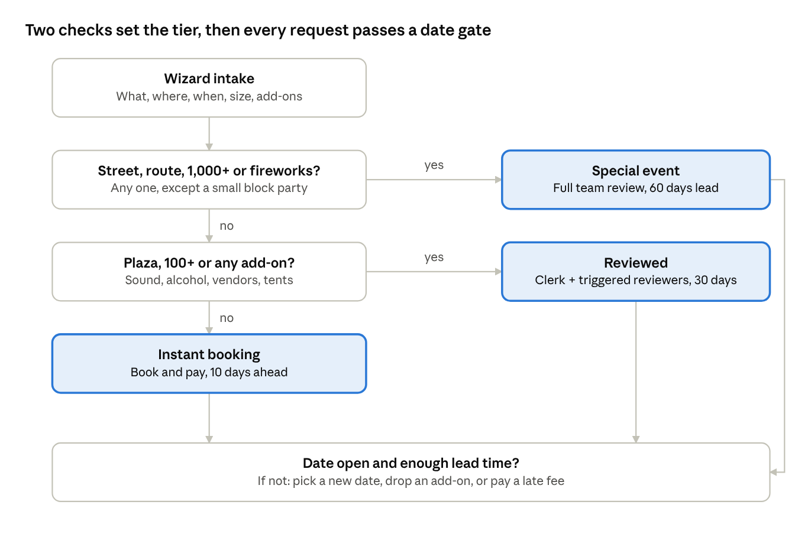
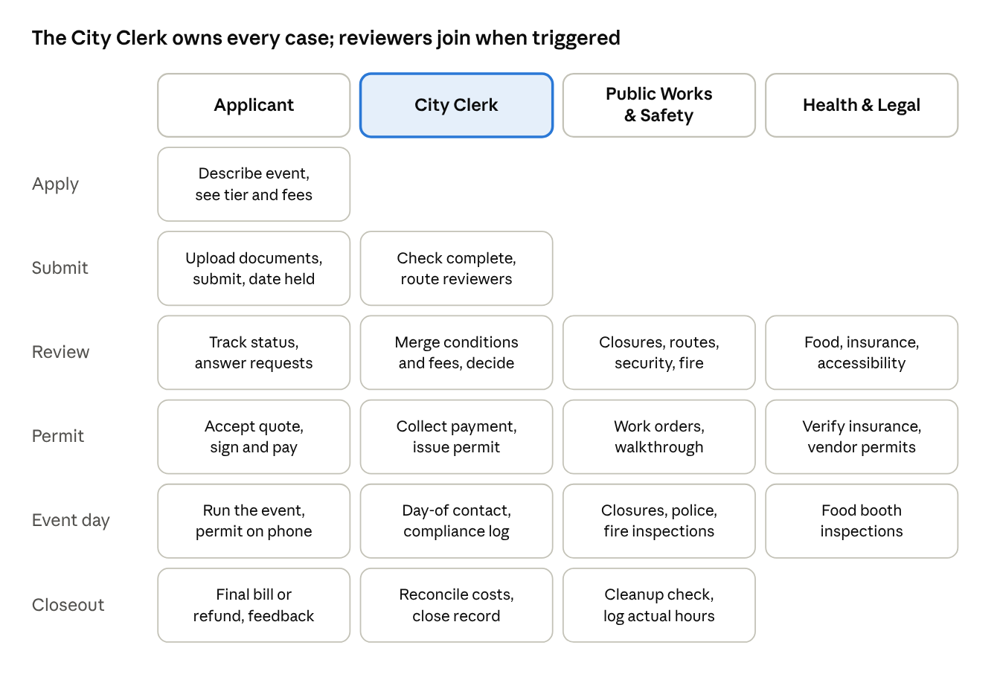

# Permitopolis: event permit flows and decision tree

Oct 12, 2026 · @Sascha

## Approach

Applicants never choose a lane: they describe their event and Permitopolis works out the tier. The biggest applicant pain in real cities is not knowing which permit they need (Boise built a separate quiz just for that), so one event-first wizard collects what, where, when, how many, and which add-ons, and a rules engine sorts the request into one of three tiers. The wizard then shows only the steps that tier needs.

- **Instant:** space comes from bookable inventory, attendance within capacity, no add-ons. Book, pay, done.

- **Reviewed:** a few add-ons such as sound, alcohol, vendors or tents. The City Clerk handles it and pulls in one or both reviewing groups.

- **Special event:** 1,000 or more attendees, street closures, a route, fireworks, or heavy city resources. Full multi-department review, 60-day lead time, a quote, and post-event reconciliation.

The middle tier exists because of a common case: a 150-person park concert with a food truck and a speaker is too much for instant booking and too little for full special-events review.

While the applicant answers, a live banner shows the result, for example "This is a Reviewed event: about 3 weeks, \$X estimated." They can see the effect of each choice, such as removing the beer garden dropping the event a tier.

## Stakeholders

The demo uses four stakeholders, each with a screen showing their own status and next steps. The City Clerk owns every case; the two reviewing groups join only when the event's triggers call for them.

| Stakeholder | Includes | Owns in the flow | Their screen shows |
|----|----|----|----|
| Applicant (organizer) | Event organizer and their team | Describing the event, documents, answering requests, accepting the quote, paying, running the event | Their events, current step, next action and deadline, each reviewer's status |
| City Clerk | Licensing, Finance / cashier | Intake, routing, consolidating conditions and fees, alcohol and vending licenses, payment, permit issuance, closeout | Intake queue by tier, cases waiting on the Clerk, reviewer progress and due dates, payments due |
| Public Works & Safety | Transportation / streets, Police (special events / traffic unit), Fire marshal / fire prevention | Street closures and routes, traffic control, security plans, structures, cooking and fireworks, day-of operations, cleanup inspection | Their review queue, closures and routes on a map and calendar, conditions and fee items, work orders |
| Health & Legal | Health department, Accessibility / ADA staff, Risk management / legal | Food and vendor permits, insurance certificates, accessibility plans, legal terms, food booth inspections | Their review queue, documents to verify, vendor permits, inspection list |

## Decision tree

The checks run in order of severity, and one trigger is enough to escalate.

tier decision tree · 2 checks, 3 tiers, 1 date gate

Every tier then passes the same lead-time and availability gate before the applicant can continue.

| Tier | Triggers (any one) | Lead time | Review |
|----|----|----|----|
| Special event | Street or route; 1,000+ attendees; fireworks; heavy city resources | 60 days | City Clerk + Public Works & Safety + Health & Legal |
| Reviewed | Plaza or open area; 100+ attendees; amplified sound; alcohol; vendors; tents or stages | 30 days | City Clerk + whichever group the add-ons trigger |
| Instant | Bookable inventory space within capacity, no add-ons | 10 days | City Clerk, exceptions only |

Block party exception: one residential block, no vendors and under 250 people is a Reviewed event, not a Special event, with neighbor sign-off as a required step.

## Applicant flow

One wizard serves every tier; Instant events skip from step 5 to step 9.

1.  **What are you planning?** Pick an event type (picnic or party, performance or rally, market or festival, race or parade, block party) and a name. The type pre-fills sensible defaults.

2.  **Where?** A map with four modes:

    - pick a bookable shelter or field from inventory

    - draw an area on a plaza or open lawn

    - select street segments

    - draw a route

3.  **When?** Date, event hours, setup and teardown, and a repeat option. A recurring event, such as a weekly class or market, becomes one series permit with a single review, each occurrence billed separately. A live check against the calendar, blackout dates and "impacted dates" runs here, before the applicant invests more effort.

4.  **How big and what's included?** Expected attendance plus add-on toggles: amplified sound, alcohol, food or vending, tents and stages, cooking or generators, fireworks or drones, admission charged, city services needed.

5.  **Your plan, at a glance.** Tier, deadlines working back from the event date, required documents, reviewing departments, and a fee estimate. The applicant confirms, edits, or creates an account here. Instant events go straight to step 9.

6.  **Details per add-on.** Only relevant sections appear: sound hours, vendor list, alcohol details, structure specs. Special events add the site plan (built on the step 2 map), traffic control, security and medical, emergency, accessibility and cleanup plans. Save and resume.

7.  **Documents and submit.** Upload the insurance certificate and other required documents, then submit. The date is held once the Clerk confirms the application is complete; if two applicants want the same space and date, the first complete application wins.

8.  **Track and respond.** A status page shows each reviewer's progress. The applicant answers requests for information there; the review clock pauses meanwhile. Special events also get a community-notification task; block parties need neighbor sign-off before the application counts as complete.

9.  **Accept and pay.** Instant events pay at booking. Reviewed and Special events receive a quote with conditions, accept with a signature, and pay fees and any deposit. The permit is issued as a QR-coded PDF.

10. **Before and on the day.** Special events get a coordination meeting, a walkthrough, and per-vendor permits. Every tier carries its permit on a phone and has a day-of contact.

11. **After.** Final bill or deposit refund, a feedback form, and "Book again next year," which clones the record.

Any time before the event, the applicant can cancel (refund set by the cancellation schedule) or amend the event. If an amendment adds a trigger, the same record moves up a tier and keeps everything already entered. This is the hardest part of the design, and the reason to keep one shared record rather than separate forms per lane.

## City flow by stakeholder

The City Clerk moves each case from intake to closeout; Public Works & Safety and Health & Legal each review only their own section, in their own queue.

swimlane · 4 stakeholders across 6 stages

An Instant booking uses only the Applicant lane, with the Clerk stepping in for exceptions; a Reviewed event adds the Clerk and whichever reviewing group its add-ons trigger; a Special event uses all four.

1.  **Intake (City Clerk).** Submissions arrive sorted by tier. Instant bookings skip this queue; only exceptions such as damage or disputes appear. The Clerk checks completeness, including neighbor sign-off for block parties, then accepts (which places the date hold) or sends a request for information. The first complete application for a space and date wins.

2.  **Consultation (City Clerk, Special events only).** The Clerk schedules the pre-application meeting and invites both reviewing groups.

3.  **Routing (City Clerk).** The system suggests reviewers from the triggers; the Clerk adjusts the list and sets due dates:

    - street, route or closure → Public Works & Safety

    - 1,000+ attendees or security needs → Public Works & Safety

    - tents, stages, cooking, generators or fireworks → Public Works & Safety

    - amplified sound → Public Works & Safety

    - alcohol → City Clerk (license) and Public Works & Safety (police)

    - food or vending → Health & Legal

    - every Reviewed and Special event → Health & Legal (insurance), plus the accessibility plan for Special events

4.  **Review (Public Works & Safety; Health & Legal).** Each group sees only its section and can approve, approve with conditions, request information, or deny, adding fee line items.

5.  **Consolidation (City Clerk).** The Clerk combines the responses, resolves conflicts between the two groups, and decides: conditionally approve, deny, or send to a commission. Denials are final in the prototype; there is no appeal step.

6.  **Quote and permit (City Clerk).** The system builds the quote, the applicant accepts, and the Clerk's cashier collects payment, per occurrence for a recurring series. The permit issues only after payment and Health & Legal's insurance check.

7.  **Pre-event (Public Works & Safety; Health & Legal).** Public Works & Safety gets work orders and runs the walkthrough; Health & Legal issues vendor food permits.

8.  **Day-of (all three city groups).** Public Works & Safety runs closures, police staffing and fire inspections; Health & Legal inspects food booths; the Clerk is the day-of contact and keeps the compliance log.

9.  **Closeout (Public Works & Safety; City Clerk).** Public Works & Safety inspects cleanup and logs actual hours; the Clerk reconciles estimated vs. actual costs, issues the final invoice or deposit refund, and closes the record.

Behind all of this, the City Clerk also manages inventory and rates, tier thresholds (configured rules, not code), the blackout calendar and templates.

## Application states

One state model connects both sides: the applicant's status page and the admin queue are two views of the same sequence.

application states · 8 on the main path, 1 side state

Instant bookings jump from Draft straight to Permitted; Reviewed and Special events pass through review and a quote.

## Demo scenarios

Six scenarios, two per tier, populate the four screens. Each sits at a different state so every stakeholder has something to act on. The demo's "today" is Monday, May 3, 2027.

| Scenario | Tier | Where and when | Size and add-ons | Who reviews | Demo state |
|----|----|----|----|----|----|
| Maya Chen's 40th birthday picnic | Instant | Shelter 3, Riverside Park; Sat May 22, 2027, 11 am–4 pm | 45 guests, no add-ons | None | Permitted: booked and paid; the Applicant sees the permit and the cancellation schedule |
| Sunrise Yoga Club weekly class | Instant, recurring | Field 4, Riverside Park; Sundays Jun 6–Aug 29, 2027, 8–9 am (13 sessions) | 20 participants, no add-ons | None | Draft: the Applicant is in the wizard and has just turned on the repeat option |
| Jazz in the Plaza | Reviewed | City Hall Plaza; Fri Jun 18, 2027, 6–9 pm | 150 attendees, amplified sound, one food truck | Public Works & Safety (sound); Health & Legal (food truck, insurance) | Needs info: Public Works & Safety approved with sound-hour conditions; Health & Legal asked for the food truck's health permit |
| Maple Street block party | Reviewed (block party exception) | 400 block of Maple Street; Sat Jun 26, 2027, 2–8 pm | 120 neighbors, one-block closure, no vendors | Public Works & Safety (closure, barricades); Health & Legal (insurance) | Submitted: waiting on 3 of 12 neighbor sign-offs, so no date hold yet |
| Riverfront Summer 5K | Special event | Downtown loop from City Hall Plaza along Main Street and River Road; Sun Jul 11, 2027, 7–11 am | 1,200 runners, street closures, amplified sound at the finish, water stations | Public Works & Safety (route, traffic control, police); Health & Legal (insurance, accessibility) | Quote sent: conditions merged by the Clerk; the Applicant must accept, sign and pay |
| Main Street Food Truck Festival | Special event | Main Street, 1st to 4th Avenue; Sat Apr 24, 2027, noon–9 pm | 3,000 attendees, 25 food trucks, beer garden, stage | City Clerk (alcohol license); Public Works & Safety (closure, police, fire); Health & Legal (vendor permits, insurance, accessibility) | Closeout: Public Works & Safety logs actual hours after the cleanup check; the Clerk reconciles costs before the final invoice |

## Decisions

All five open questions are settled for the prototype; only the length of a date hold is still open.

| Question | Decision |
|----|----|
| Block parties | Exception: one residential block, no vendors, under 250 people → Reviewed, with neighbor sign-off required |
| Date holds | The first complete application wins the hold; Instant bookings hold the date on payment |
| Recurring events | Supported: one series permit, one review, each occurrence billed separately |
| Denials | Final; no appeal step in the prototype |
| Demo scenarios | Two per tier, listed under Demo scenarios |

- [ ] How long does a date hold last before it expires?
