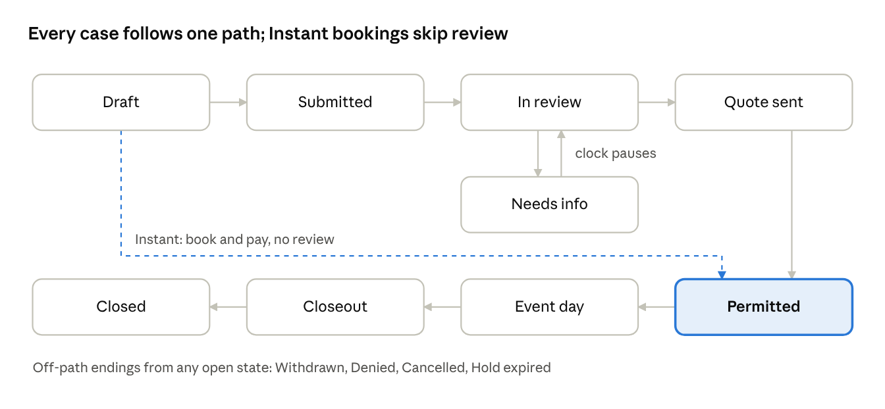
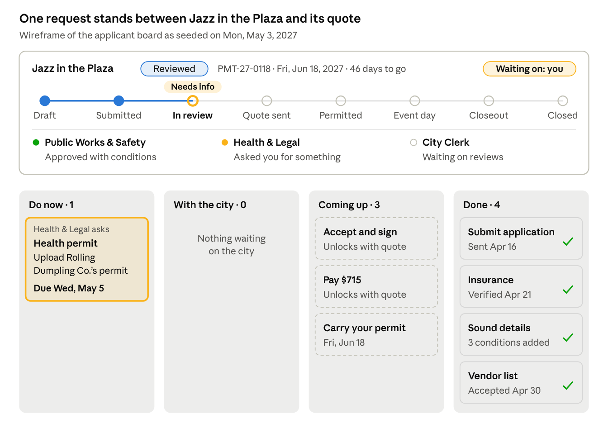
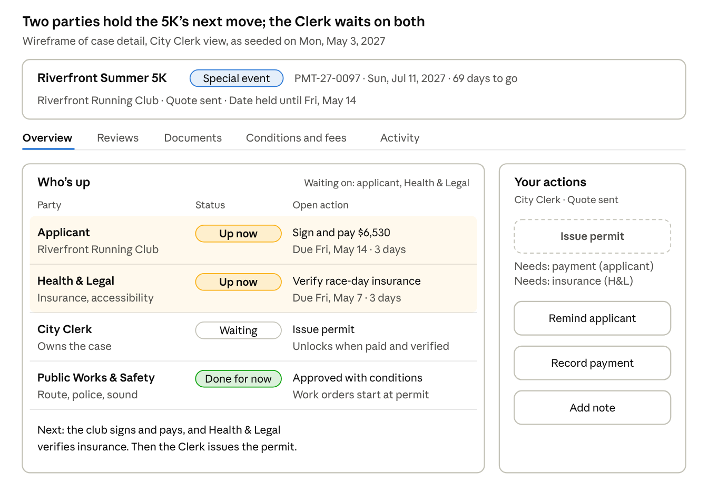

# Permitopolis Events Permitting: Prototype PRD

Oct 12, 2026 · @Sascha

Build a clickable, front-end-only prototype of the Permitopolis City Clerk's event permitting site and deploy it on Vercel. Applicants get a wizard that works out their tier and permits, ending in a board of to-do cards. The City Clerk, Public Works & Safety and Health & Legal each see every case's state, whose move it is, and the active permits.

Six seeded scenarios on a fixed demo date, Monday, May 3, 2027, give every screen something to act on. Sources: the event permit flows doc and the demo scenarios sheet. Priorities: P0 is needed for the demo script, P1 should ship, P2 is nice to have.

## Scope

The prototype must let one presenter walk all four roles through six cases in one browser, with every click changing shared state. Nothing real sits behind it.

**Goals**

- Applicants never pick a permit. They describe the event and watch the tier, permits, deadlines and fees update live.

- The plan becomes a board of to-do cards. Each card is one document to upload or one action to take, with why it is needed and when it is due.

- Each city role gets a queue of what is waiting on them and a case view that shows the state and every outstanding action by owner.

- Active permits show on a list, calendar and map, with day-of and closeout tasks.

- The demo survives a live audience: deterministic seed data, a fixed demo date, one-click reset, no login.

**Faked or left out**

- No backend, database, auth, email or real payments. State lives in the browser and resets to the seed.

- Uploads keep only the file name, size and type. Every upload has a "Use sample file" button.

- Payments and signatures are simulated forms that always succeed (test card prefilled).

- No map tiles or geocoding. Permitopolis is a fictional city drawn as SVG.

- No appeals (denials are final), no commission workflow beyond a marker, no notifications outside the app, English only.

**Success test**

- Every path in the demo script runs from the seed with no dead clicks, and Reset restores the seed.

- Every role's home screen loads with at least one item it can act on.

- Unit tests show the rules engine puts all six scenarios in the tier the scenarios sheet gives.

- City screens work from 1280 px wide; applicant screens work down to 375 px, because applicants carry the permit on a phone.

## Stack and architecture

A Next.js app on Vercel with all state in one client-side store, seeded from TypeScript fixtures. There is no server code and no environment variable to set.

| Concern | Choice | Why |
|----|----|----|
| Framework | Next.js, latest stable (App Router), TypeScript | Deploys to Vercel with zero config |
| UI | Tailwind CSS, shadcn/ui (Radix), lucide-react icons | Accessible dialogs, sheets, tabs and menus out of the box |
| State | Zustand with persist to localStorage, key permitopolis-demo-v1 | One store for all roles, so a click as the Applicant shows up for the Clerk |
| Dates | date-fns plus a demoToday() helper; never call new Date() in features | The demo date defaults to 2027-05-03 and can be changed |
| Map | Hand-built SVG of Permitopolis, one React component per feature | Click to select spaces and streets, drag to draw an area; no API keys |
| Calendar | Small custom month and week grid; react-day-picker for date inputs | Avoids a heavy calendar library |
| Permit | qrcode.react; a print stylesheet so "Download PDF" uses window.print() | No PDF library needed |
| Signature | Typed full name plus a consent checkbox | Enough for a prototype |
| Tests | Vitest for rules and state transitions; Playwright smoke test of the demo script (P1) | Rules are the part most likely to drift |
| Deploy | Vercel, Git-connected, a preview per branch | Share a preview link after each milestone |

**Folder layout**

app/  
page.tsx landing and demo guide  
apply/ wizard, steps 1-5  
events/ applicant: my events, board, quote, permit  
city/ city shell: queue, cases, active, role tools  
verify/\[id\]/ public permit check (QR target)  
lib/  
rules/ config.ts classify.ts routing.ts requirements.ts fees.ts leadTime.ts  
state/ store.ts transitions.ts waitingOn.ts seed/  
data/ inventory.ts streets.ts calendar.ts fees.ts people.ts  
components/  
map/ wizard/ board/ case/ calendar/ ui/

**Rules for the build**

- Rules and state transitions are pure functions in lib/, covered by tests. Components call them and never re-implement them.

- Tier thresholds, lead times and fees live in lib/rules/config.ts and lib/data/, not in component code. The flows doc asks for "configured rules, not code", and the Clerk's settings screen edits these values.

- Every state change goes through one transition(caseId, action, actor) function that checks preconditions, updates tasks and writes an activity entry.

- All copy is plain language. Dates read like "Sat, Jun 26, 2027"; money reads like "\$1,240".

## Core model

One record per event carries everything from the first wizard answer to closeout. Tier, state, the applicant's board and the city's queues are all views of that record, never separate forms.

| Entity | Key fields | Notes |
|----|----|----|
| EventCase | id (e.g. PMT-27-0142), applicantId, name, eventType, tier, triggers\[\], location, schedule, attendance, addOns, state, ending, dateHold, reviews\[\], tasks\[\], conditions\[\], feeLines\[\], payments\[\], activity\[\], permit | The shared record. ending holds Withdrawn, Denied, Cancelled or Hold expired |
| Location | mode (inventory, area, streets, route), inventoryIds\[\], areaRect, segmentIds\[\], capacity, square feet, miles | Drawn on the Permitopolis SVG map |
| Schedule | date, start, end, setupStart, teardownEnd, recurrence (frequency, weekday, until), occurrences\[\] | A series is one record; each occurrence is billed separately |
| Review | dept (Clerk license, Public Works & Safety, Health & Legal), sections\[\], status, dueDate, clock (started, paused days), internalNote, messageToApplicant | Status: not routed, pending, approved, approved with conditions, needs info, denied |
| Task | id, owner (applicant, clerk, pws, hl), kind, title, why, reviewer, dueDate, status, unlocksOn, phase, payload | Kind: document, form, action, payment, sign-off, meeting, review, inspection. Status: locked, to do, submitted, changes requested, done |
| FeeLine | dept, label, qty, unit, unitPrice, estimate, actual | Actuals are filled in at closeout |
| Condition | dept, text, mergedByClerk, acceptedByApplicant | Shown on the quote and the permit |
| DateHold | status (none, held, expired, released), placedOn, expiresOn | Placed when the Clerk accepts an application as complete |
| Activity | at, actor, text | The case timeline on both sides |

**Tasks drive "waiting on"**

The applicant's to-do cards and the city's outstanding actions are the same Task objects, filtered by owner. Nobody sets "waiting on" by hand:

- waitingOn(case) returns every owner with a task in to do or changes requested, plus every department with a pending review.

- Each owner shows with its oldest due date and how many days the case has sat with them.

- A case before Permitted with nobody waiting is a bug. Development builds show a red "Stalled" chip.

Scenario S4 shows why this matters: it sits in Submitted, yet the next move belongs to the neighbors, not the Clerk. State alone would hide that.

**States and transitions**

Needs info is a side state of In review. If any routed review asks for information, the case shows Needs info and its review clock pauses until the applicant responds.

| From | To | Who acts | Preconditions and effects |
|----|----|----|----|
| Draft | Permitted | Applicant pays | Instant only. Date open and at least 10 days out. Date held on payment; permit issued at once |
| Draft | Submitted | Applicant submits | Every pre-submit card done. Creates the Clerk's intake task |
| Submitted | In review | Clerk accepts as complete | Places the date hold; the first complete application for a space and date wins. Block parties need every neighbor sign-off. Clerk confirms routing, which creates review tasks with due dates |
| Submitted or In review | Needs info | Clerk at intake, or any reviewer | Creates an applicant card carrying the message; review clock pauses |
| Needs info | In review | Applicant responds | Card moves to With the city; the asking reviewer gets a re-review task; clock resumes |
| In review | Quote sent | Clerk consolidates and approves with conditions | Every routed review approved, with or without conditions. Quote built from fee lines; hold expiry set |
| In review | Denied | Clerk | Final, no appeal; reason shown to the applicant |
| Quote sent | Permitted | Clerk issues the permit | Applicant accepted, signed and paid, and Health & Legal verified insurance |
| Quote sent | Hold expired | System, on the demo date | Hold expiry passed unpaid; space and date released |
| Permitted | Event day | System, on the demo date | Demo date equals the event date, or each occurrence for a series |
| Event day | Closeout | System, the day after | Creates the Public Works & Safety cleanup and hours tasks and the Clerk's reconciliation task. Instant events with no city services skip straight to Closed |
| Closeout | Closed | Clerk issues the final invoice or refund | Applicant gets a payment or refund card, then the feedback form |
| Any open state | Withdrawn or Cancelled | Applicant | Withdrawn before a permit exists; Cancelled after, with the refund from the cancellation schedule |

"Sent to commission" is a flag on In review, not a state: a banner on the case, after which the Clerk still approves or denies.

## App shell, routes and demo controls

Everyone uses one app with no login. A persistent top bar switches between the Applicant and the three city roles, and a Demo menu controls the seed and the date.

**Top bar**

- Left: the Permitopolis wordmark and "City Clerk · Events Permitting".

- Center: a role switcher with four segments: Applicant, City Clerk, Public Works & Safety, Health & Legal.

- Right: a date chip, "Demo today: Mon, May 3, 2027", and the Demo menu.

- In the Applicant role, a persona picker sits next to the switcher: Maya Chen (S1), Sunrise Yoga Club (S2), Downtown Arts Collective (S3), Maple Street block captain (S4), Riverfront Running Club (S5), Main Street Business Alliance (S6), and New applicant for a blank wizard run. Names other than Maya Chen are placeholders.

- City roles get a left sidebar: My queue (with a count), Cases, Active permits, then that role's own tools.

**Demo menu**

- Reset demo data, confirmed in a dialog component (never window.confirm).

- Set demo date. Jumping to Fri, Jun 18, 2027 puts Jazz in the Plaza on Event day if it has been permitted.

- Scenario jump list, S1 to S6: each opens the right role, persona and page.

- Demo hints on or off: small callouts that say what to click next in the demo script.

- The app remembers the last role and page per role in localStorage, wrapped in try/catch so it still works when storage is blocked.

**Look and feel**

- Calm civic style: white surfaces, Public Sans, one blue accent, generous type, plain-language copy.

- Each party has a color used on every chip and avatar: Applicant slate, City Clerk blue, Public Works & Safety amber, Health & Legal teal. Color always comes with an icon and a label.

- Tier badges: Instant green, Reviewed blue, Special event purple, each with its name spelled out.

- WCAG 2.2 AA: keyboard reachable, visible focus, status changes announced through aria-live.

**Route map**

| Route | Role | View | Priority |
|----|----|----|----|
| / | All | Landing: "Plan an event" and "City staff" doors, plus the demo guide | P0 |
| /apply | Applicant | Wizard, steps 1 to 5 (?step=what, where, when, size, plan) | P0 |
| /events | Applicant | My events, with state and next action per event | P0 |
| /events/\[id\] | Applicant | Event board: status strip, reviewers, to-do cards | P0 |
| /events/\[id\]/quote | Applicant | Quote: conditions, fees, sign, pay | P0 |
| /events/\[id\]/permit | Applicant | Permit with QR code, conditions, day-of contact, cancellation schedule | P0 |
| /events/\[id\]/amend | Applicant | Wizard reopened on the same record | P1 |
| /verify/\[id\] | Public | What an officer sees after scanning the QR code: valid or not, place, hours, conditions | P1 |
| /city/queue | Each city role | My queue: actions waiting on me | P0 |
| /city/cases | Each city role | Cases pipeline, board by state or table | P0 |
| /city/cases/\[id\] | Each city role | Case detail with "Who's up" and the role's action panel | P0 |
| /city/active | Each city role | Active permits: list, calendar, map | P0 |
| /city/intake | City Clerk | Intake queue by tier | P0 |
| /city/payments | City Clerk | Payments due, received and refunds | P1 |
| /city/settings | City Clerk | Inventory and rates, tier rules, blackout dates, templates | P2 |
| /city/map | Public Works & Safety | Closures and routes on the map, with a calendar strip | P1 |
| /city/work-orders | Public Works & Safety | Work orders and walkthroughs | P1 |
| /city/verifications | Health & Legal | Documents to verify across cases | P1 |
| /city/inspections | Health & Legal | Food booth inspections by event | P2 |

## Applicant wizard

Five plain questions, a live result panel that changes with every answer, and a plan summary that becomes the to-do board. Instant events pay at the end of step 5 and go straight to their permit.

**How it behaves**

- Step content on the left, the live result panel on the right; on mobile the panel is a bottom sheet with a one-line summary.

- The panel shows the tier and a one-line summary ("This is a Reviewed event: about 3 weeks, \$715 estimated"), the triggers as chips, the lead time and earliest possible date, the permits included, the reviewers and the fee estimate.

- What-if: any trigger chip that alone holds the tier shows what removing it would do ("Remove the beer garden: Instant, book today"). Compute it by re-running classify() without that trigger.

- Every change autosaves to the draft record. Back, Next, "Save and finish later", and a 1-to-5 stepper with edit links.

- A tier change gets a short highlight and an aria-live announcement.

**Steps**

1.  **What are you planning?**

    - Event type cards: Picnic or party, Performance or rally, Market or festival, Race or parade, Block party, Class or club meetup (added so S2 has a home), and Other (the description says what it is).

    - Event name and an optional one-line description.

    - The type pre-fills one default: Class or club meetup turns on repeat. No type turns on an add-on; food or vending (and the vendor count) is chosen on step 4 like every other add-on. The map on the next step opens on bookable spaces whatever the type.

    - The live result panel opens with a "Your event" recap on every step: the type, name and description, then the place, date and hours, sessions, attendance and add-ons as each step answers them.

2.  **Where?**

    - The Permitopolis SVG map with four mode tabs:

    - Bookable spaces: click a shelter or field; its card shows capacity, amenities, hourly rate and availability.

    - Draw an area: drag a rectangle inside City Hall Plaza or the Great Lawn; shows square feet and capacity at 10 sq ft per person.

    - Street segments: click blocks; residential blocks are marked.

    - Draw a route: click connected segments in order; shows miles, with Undo last segment.

    - A list under the map does the same selection by keyboard.

    - Choosing a street or route adds a Street closure trigger at once, unless the block-party exception applies.

3.  **When?**

    - Date, start and end times, setup start and teardown end.

    - Repeat: weekly or every two weeks, weekday, end date. Shows the session count ("13 sessions") and each date with its availability.

    - Live availability check against bookings, blackout dates and impacted dates: Open, Impacted ("Riverfront Summer 5K closes Main Street 6 to 11:30 am that day"), or Booked and Blackout with the next open dates.

    - Lead-time gate: when the date is too close for the tier, offer three fixes: pick a new date (the earliest valid date as a button), drop an add-on (only those that lower the tier), or pay a late fee.

4.  **How big and what's included?**

    - Expected attendance.

    - Add-on toggles, each with its effect in one line ("Adds a sound approval, reviewed by Public Works & Safety, \$40"): Amplified sound, Alcohol, Food or vending (number of vendors), Tents and stages (count), Cooking or generators, Fireworks or drones, Admission charged, City services needed (barricades, trash, power, police).

    - Attendance above a bookable space's capacity shows a warning and suggests a larger space.

5.  **Your plan at a glance**

    - Tier card with its reasons.

    - "You need one Permitopolis event permit. It covers:" followed by the permit components that apply (see Rules).

    - Reviewing departments, each with one line on what they check.

    - A timeline worked back from the event date: submit by, reviews done by, quote paid by, walkthrough, event day.

    - The documents and actions to come, grouped by phase; these become the board's cards.

    - Fee estimate: line items, deposit, total; a series shows per session and in total.

    - Account: "Create your account", prefilled from the persona, one click.

    - Primary button: Instant shows "Book and pay \$125", which opens payment and then the permit. Reviewed and Special show "Create my to-do board".

**Acceptance**

- S3's answers give Reviewed, a 30-day lead time, Public Works & Safety and Health & Legal as reviewers, and \$715 including the deposit.

- S5's answers give Special event, a 60-day lead time and all three city groups.

- A 40-person picnic at a shelter with alcohol shows Reviewed; turning alcohol off shows Instant.

- S4's answers trigger the block-party exception: Reviewed, not Special, with a neighbor sign-off card.

## Applicant to-do board

After the wizard, each event's home is a board of cards. Every card is one document to upload or one action to take, and says why it is needed, who reviews it and when it is due. The board replaces steps 6 to 11 of the flows doc, so the applicant sees the whole journey on day one.

**Status strip (top of the board)**

- Event name, tier badge, case ID, event date and days to go.

- State stepper: Draft, Submitted, In review, Quote sent, Permitted, Event day, Closeout, Closed. Needs info shows as an amber marker on In review.

- Date hold: "Date held until Fri, May 14" or "No date hold yet: 3 neighbor sign-offs to go".

- "Waiting on" chips, in the applicant's words: "You", "City Clerk", "Public Works & Safety", "Health & Legal".

- Reviewers row: each department with its status in plain words: Approved, Approved with conditions, Asked you for something, Reviewing, Not involved.

**Columns**

| Column | Holds | A card lands here when |
|----|----|----|
| Do now | Unlocked cards the applicant owns, sorted by due date. City requests are pinned on top with the reviewer's message | The plan creates it, a gate unlocks it, or a reviewer asks for information or changes |
| With the city | Cards the applicant finished that a reviewer still has to accept | The applicant uploads, submits a form or completes an action that needs a check |
| Coming up | Locked cards for later stages, each saying what unlocks it | The plan creates it ("Unlocks when your quote is ready") |
| Done | Accepted or completed cards | A reviewer accepts it, or the action needs no check |

A toggle groups cards into phase swimlanes: Before submitting, Review, Permit, Before the event, Event day, After. On mobile the columns become tabs with counts.

**Card anatomy**

- Kind icon and label: Document, Form, Action, Payment, Sign-off, Meeting.

- Title, plus a "Why" line naming the answer that created it ("Because you added amplified sound").

- Reviewer chip in the department's color, due date as relative and absolute ("Due in 6 days · Sat, May 8"), red when overdue.

- Sign-off cards show progress ("9 of 12 neighbors"); payment cards show the amount.

**Card detail sheet (opens from the right)**

- Document: what counts as acceptable, a template or example, a drop zone with "Use sample file", the file list, the reviewer's comments and the status history.

- Form: the add-on form inline: sound hours and equipment, vendor rows, alcohol details, structure specs, or the special-event plans (site plan drawn on the step 2 map; traffic control, security and medical, emergency, accessibility and cleanup as short structured forms with an optional upload).

- Action: what to do and one primary button, such as "Copy the neighbor sign-off link" (with a demo-only "Simulate a sign-off" button) or "Upload a photo of the posted notice".

- Payment: line items, total, and a simulated card form with a test card prefilled.

- City request: the reviewer's message, the requested item, and "Reply and attach".

**Submit and series**

- "Submit application" is itself a card. It stays locked until every pre-submit card is done, then pins to the top of Do now. Submitting moves the case to Submitted.

- A recurring series has one board. Its payment card bills per session and opens a schedule of all sessions marked paid, due or upcoming.

**Card catalogue**

| Card | Kind | Created when | Reviewed by | Due by default |
|----|----|----|----|----|
| Certificate of insurance | Document | Every Reviewed and Special event | Health & Legal | Before submitting |
| Sound details | Form | Amplified sound | Public Works & Safety | Before submitting |
| Alcohol details and liquor liability insurance | Form and document | Alcohol | City Clerk (license), Public Works & Safety (police) | Before submitting |
| Vendor list | Form | Food or vending | Health & Legal | Before submitting |
| Vendor health permit, one per food vendor | Document | Food or vending | Health & Legal | 14 days before the event |
| Structure specs and layout | Document | Tents and stages | Public Works & Safety (fire) | Before submitting |
| Cooking and generator safety | Form | Cooking or generators | Public Works & Safety (fire) | Before submitting |
| Pyrotechnics or drone operator license | Document | Fireworks or drones | Public Works & Safety (fire) | Before submitting |
| City services request | Form | City services needed | Public Works & Safety | Before submitting |
| Site plan | Form on the map | Special event | Public Works & Safety | Before submitting |
| Traffic control plan | Document | Street, route or closure | Public Works & Safety | Before submitting |
| Security and medical plan | Document | Special event or 1,000+ people | Public Works & Safety | Before submitting |
| Emergency plan | Document | Special event | Public Works & Safety | Before submitting |
| Accessibility plan | Form | Special event | Health & Legal | Before submitting |
| Cleanup plan | Form | Special event | Public Works & Safety | Before submitting |
| Neighbor sign-off | Sign-off | Block party | City Clerk | Before the Clerk can accept |
| Submit application | Action | Reviewed and Special events | City Clerk | Event date minus the lead time |
| Pre-application meeting | Meeting | Special event, after acceptance | City Clerk with both groups | 7 days after acceptance |
| Community notification | Action | Special event | City Clerk | 30 days before the event |
| Respond to a request | Action | A reviewer asks for information | That reviewer | 5 days after the request |
| Accept conditions and sign | Sign-off | Quote sent | City Clerk | Date hold expiry |
| Pay fees and deposit | Payment | Quote sent; at booking for Instant | City Clerk (cashier) | Date hold expiry |
| Coordination meeting | Meeting | Special event, after Permitted | City Clerk, Public Works & Safety | 21 days before the event |
| Site walkthrough | Meeting | Special event | Public Works & Safety | 7 days before the event |
| Per-vendor food permits | Download | Special event with vendors | Health & Legal | 7 days before the event |
| Carry your permit | Action | Permitted | None | Event day |
| Final bill or refund | Payment | Clerk closes reconciliation | City Clerk | 14 days after the invoice |
| Feedback | Form | Closed | City Clerk | None |
| Book again next year | Action | Closed | None | None |

applicant board · S3 Jazz in the Plaza, wireframe

On May 3, S3's board shows one pinned request in Do now, nothing with the city, three locked cards and four done; the status strip says the move is the applicant's.

## Quote, permit, amend and cancel

Reviewed and Special events end review with a quote to accept, sign and pay. The permit issues only after payment and Health & Legal's insurance check, and every later change happens on the same record.

**Quote (/events/\[id\]/quote, P0)**

- Summary of the approved plan, with the date-hold countdown ("Pay by Fri, May 14 to keep your date").

- Conditions grouped by department, each with an "I accept" checkbox. Example for S3: "Sound ends at 9 pm; speakers face away from the residences on Elm Street; no more than 85 dB at 50 feet."

- Fee table: each department's lines, base fees, refundable deposit, total. A series shows the first session now and the rest on schedule.

- Typed full-name signature, then a simulated card payment.

- After paying, the strip shows who is still up. If Health & Legal has not verified insurance yet: "Paid. Waiting on Health & Legal to verify your insurance." Otherwise the Clerk's issue step runs and the permit appears.

**Permit (/events/\[id\]/permit, P0)**

- Mobile-first page: QR code (encodes the case ID and /verify/\[id\]), event name, place with a map thumbnail, date and hours (all sessions for a series), conditions, day-of contact (Clerk's name and phone), cancellation schedule with today's refund amount.

- "Download PDF" prints the page through a print stylesheet.

- /verify/\[id\] (P1) is the officer's view after scanning: a large Valid or Not valid, the event, place, hours and conditions.

**Amend (/events/\[id\]/amend, P1)**

- Reopens the wizard on the same record with every answer filled in, and re-runs classify() on each change.

- If the tier rises, a banner says so and keeps everything: "This change makes your event Reviewed. Everything you entered is kept; 3 new cards will be added."

- The lead-time gate runs again. Example: Maya (S1) adds a DJ, which makes her picnic Reviewed, but May 22 is 19 days away and Reviewed needs 30. She picks a new date, drops the DJ, or pays the late fee.

- The current permit stays valid for the original plan until the amendment is approved. New cards carry an "Amendment" tag on the board.

**Cancel and withdraw (P0)**

- From the board's menu. Before a permit exists it is Withdraw, with no fees owed. After, it is Cancel, which shows the refund for the demo date from the cancellation schedule before confirming.

- Either ending releases the date hold and clears the case from every city queue, with an activity entry.

**After the event (P0)**

- Closeout shows the final bill or deposit refund, with estimated and actual costs side by side.

- Once Closed: a short feedback form and "Book again next year", which clones the record as a new Draft on the same weekday a year later.

## City views shared by all three roles

Every city role gets the same four views, filtered to what that role touches, so state and "whose move" read the same way everywhere. Each role then adds its own tools (next three sections).

**My queue (/city/queue, P0)**

- The role's home. Lists every task owned by this role that can be acted on now, grouped Overdue, Due this week, Later.

- Row: event name and case ID, tier badge, the task ("Verify insurance certificate"), due date, days the case has waited on this role, state chip.

- A collapsed "Waiting on others" group lists cases this role is involved in where the move is someone else's, with who and since when.

- Clicking a row opens the case with that task's panel already open.

**Cases pipeline (/city/cases, P0)**

- Board view: one column per state (Submitted, In review, Needs info, Quote sent, Permitted, Event day, Closeout). Each card shows event name, tier, event date, days to go, and a "Waiting on" row of party chips with days ("Applicant · 4d", "Health & Legal · 2d").

- Table view: ID, event, tier, event date, state, waiting on, next action, due, a status dot per department, and a lead-time risk flag.

- Filters: tier, state, waiting on (me, applicant, another department), event date range, and "Involves me", which is on by default for Public Works & Safety and Health & Legal. Closed and off-path cases sit behind a filter.

- Lead-time risk: red when the review days left are fewer than the days the remaining steps need.

**Case detail (/city/cases/\[id\], P0)**

- Header: event, ID, tier, applicant, event date and days to go, the state stepper, date-hold status, and the review clock ("Day 9 of 21 · paused 2 days").

- "Who's up" panel, the centerpiece: one row per party (Applicant, City Clerk, Public Works & Safety, Health & Legal) with status (Up now, Done for now, Waiting, Not involved), each open action with its due date, and days holding the case. The party or parties up now are highlighted.

- Under the panel, one generated sentence names the next move: "Next: Downtown Arts Collective uploads the food truck's health permit, then Health & Legal re-reviews."

- Tabs: Overview (event summary, map, schedule, attendance, add-ons, triggers), Reviews (each department's section, decision, conditions, fee lines; only the viewer's own section is editable), Documents, Conditions and fees, Activity.

- A sticky action panel on the right shows only what this role can do in this state. Disabled actions say why ("Waiting on 3 neighbor sign-offs").

**Active permits (/city/active, P0)**

- Every case in Permitted, Event day or Closeout, plus a toggle for Quote sent cases holding a date.

- Three views: List sorted by event date; Calendar (month and week, colored by tier, each series session shown); Map (the Permitopolis SVG showing booked spaces, closures and routes for the chosen day or week).

- A Today strip: "Mon, May 3: no events today" and the next 7 days.

- Role overlays: Public Works & Safety sees work orders, closures and walkthroughs; Health & Legal sees inspections and vendor permits; the Clerk sees day-of contact duty and compliance logs.

- A Closeout tab lists events still being reconciled, with the remaining steps and who holds them.

case detail · S5 Riverfront Summer 5K, City Clerk view, wireframe

The Clerk's view of S5 on May 3: the applicant and Health & Legal are both up, so Issue permit stays disabled and names what it is waiting for.

## City Clerk views

The Clerk owns every case from intake to closeout, so the Clerk's tools cover the hand-offs: accepting, routing, merging, quoting, collecting, issuing and reconciling.

| Tool | What the Clerk does | Demo with | Priority |
|----|----|----|----|
| Intake queue (/city/intake) | Tabs for Special, Reviewed and Instant exceptions. Each row shows a completeness summary ("7 of 8 items"), any competing application for the same space and date (and which was complete first), and lead-time status. Actions: Accept as complete, which places the date hold, or Request info, which picks items, adds a message and creates an applicant card | S4 (Accept disabled until neighbors sign) and a filler Special event | P0 |
| Routing (case detail, after Accept) | Suggested reviewers from the triggers, each with its reason ("Amplified sound: Public Works & Safety"). The Clerk adds or removes reviewers, sets a due date for each, and confirms, which moves the case to In review | S4 after sign-offs | P0 |
| Consultation | For Special events: schedule the pre-application meeting and invite both groups; it appears on all three calendars | Filler Special event | P1 |
| Licenses | The Clerk reviews alcohol and vending licenses as its own review section, like any department | S6 history | P1 |
| Consolidation | Side-by-side view of each review's decision, conditions and fee lines. Flags conflicts (two groups setting different end times). The Clerk edits and merges conditions into one list, then decides: Approve with conditions, Deny (with a reason; final), or Send to commission (a flag) | S3 once Health & Legal approves | P0 |
| Quote builder | Lines generated from the fee schedule and review fee lines, editable; deposit; late fee when it applies. Send moves the case to Quote sent and unlocks the applicant's sign and pay cards | S3 | P0 |
| Payments (/city/payments) | Payments due, received and refunds owed. Mark an in-person payment received (cashier). Series show each session's payment | S2, S5 | P1 |
| Issue permit | Enabled only when paid and insurance is verified; otherwise names what is missing | S5 | P0 |
| Day-of | Clerk is the day-of contact. Compliance log on Event day: time-stamped notes with an Issue flag | Set the demo date to Jun 18 after S3 is permitted | P2 |
| Closeout reconciliation | Estimated vs actual by line, using Public Works & Safety's logged hours. The difference becomes a final invoice or is taken from the deposit, with the rest refunded. Close record | S6 | P0 |
| Settings (/city/settings) | Inventory and rates, tier thresholds (100, 1,000, 250 for block parties, lead times 10, 30 and 60 days), blackout calendar, templates for conditions and requests. Changing a threshold re-classifies open drafts live | New applicant draft | P2 |

## Public Works & Safety views

Public Works & Safety sees only its sections of the cases routed to it, plus a map and calendar of closures and the operational work before, during and after each event.

| Tool | What Public Works & Safety does | Demo with | Priority |
|----|----|----|----|
| Review queue (My queue) | Cases routed here, each showing the triggers that routed it (closure, route, sound, structures, police for alcohol, 1,000+ people), due date and review clock | S4 after routing | P0 |
| Review panel (case detail) | Only its sections: sound details, site plan, traffic control, security and medical, structures and fire, cleanup. Decision: Approve, Approve with conditions (condition templates plus free text), Request info (creates an applicant card), or Deny with a reason | S3 history, S5 history | P0 |
| Fee lines | Adds estimated lines: officers × hours × rate, barricades, closure fees, fire inspection | S5 | P0 |
| Closures and routes (/city/map) | The Permitopolis map for a chosen date range: every closure, route and occupied plaza, colored by status (held, permitted, pending), with overlaps highlighted and a calendar strip below | S5 route on Jul 11 | P1 |
| Work orders (/city/work-orders) | Generated when a case is permitted, from approved services and fee lines: barricade delivery, police staffing, trash, power. Status scheduled or done. Walkthrough scheduling | S5 after permit | P1 |
| Day-of | Closure checklist (closed at, reopened at), police roster, fire inspection pass or fail | Demo date set to Jul 11 | P2 |
| Closeout | Cleanup inspection (pass, or issues with a sample photo), then actual hours per fee line next to the estimate. Submitting creates the Clerk's reconciliation task | S6 | P0 |

## Health & Legal views

Health & Legal verifies documents and runs food and accessibility checks, so its views center on a verification queue and an inspection list.

| Tool | What Health & Legal does | Demo with | Priority |
|----|----|----|----|
| Review queue (My queue) | Cases routed for insurance (every Reviewed and Special event), food or vending, and accessibility (Special events) | S3, S5 | P0 |
| Review panel (case detail) | Only its sections. Same four decisions as other reviewers, plus fee lines (vendor permits at \$75 each) | S3 | P0 |
| Verifications (/city/verifications) | One queue of documents across cases. Each opens a mock preview and a checklist. Insurance: named insured matches the applicant, City of Permitopolis is an additional insured, at least \$1M per occurrence, dates cover setup through teardown. Health permit: vendor name, permit number, valid past the event date. Accessibility plan: accessible route, accessible restrooms, viewing area. Actions: Verify, or Reject with a reason, which sends the card back to the applicant as "Changes requested" | S3 food truck permit, S5 insurance | P0 in case detail, P1 as its own page |
| Vendor permits | Per event: each vendor, its health permit status, and an Issue food permit action (pre-event for Special events) | S6 history | P1 |
| Inspections (/city/inspections) | Day-of food booth list per event: booth, vendor, pass, fail or re-inspect, notes | Demo date set to Jun 18 | P2 |

## Rules and reference data

One classify() call over the record returns the tier, triggers, reviewers, cards and fee estimate. Tiers and routing come from the flows doc; fees, capacities, the cancellation schedule and the map are placeholders for the demo, kept in lib/data/.

**classify(), in order (one trigger is enough to escalate)**

1.  Special event if any: a street segment or route (unless the block-party exception applies), 1,000 or more people, fireworks or drones, or heavy city resources (police staffing or more than 20 barricades, a placeholder threshold).

2.  Block-party exception: type Block party, exactly one residential block, no food or vending, and fewer than 250 people. Result: Reviewed, plus a neighbor sign-off card.

3.  Reviewed if any: a plaza or open-area location, 100 or more people, or any add-on.

4.  Otherwise Instant: a bookable space with attendance within its capacity.

5.  Every tier then passes the date gate: the date is open (no booking or blackout) and the days until the event meet the lead time. If not, offer a new date, dropping an add-on, or a late fee.

| Tier | Triggers (any one) | Lead time | Review |
|----|----|----|----|
| Special event | Street or route; 1,000+ people; fireworks; heavy city resources | 60 days | City Clerk, Public Works & Safety, Health & Legal |
| Reviewed | Plaza or open area; 100+ people; amplified sound; alcohol; vendors; tents or stages; any other add-on | 30 days | City Clerk plus whichever group the add-ons trigger |
| Instant | Bookable space within capacity, no add-ons | 10 days | City Clerk, exceptions only |

**Routing (suggested reviewers; the Clerk can adjust)**

| Trigger | Routed to |
|----|----|
| Street, route or closure | Public Works & Safety |
| 1,000+ people or security needs | Public Works & Safety |
| Tents, stages, cooking, generators or fireworks | Public Works & Safety |
| Amplified sound | Public Works & Safety |
| Alcohol | City Clerk (license) and Public Works & Safety (police) |
| Food or vending | Health & Legal |
| Every Reviewed and Special event | Health & Legal (insurance); Special events add the accessibility plan |

**Permit components (what "one permit covers" lists)**

| Component | Applies when | Approved by |
|----|----|----|
| Space reservation | Shelter or field | City Clerk (automatic for Instant) |
| Public space use | Plaza or open area | City Clerk |
| Street closure or route approval | Street segments or route | Public Works & Safety |
| Amplified sound approval | Amplified sound | Public Works & Safety |
| Temporary alcohol license | Alcohol | City Clerk, with Public Works & Safety for police |
| Temporary food and vendor permits | Food or vending | Health & Legal |
| Structure and fire approval | Tents, stages, cooking, generators, fireworks, drones | Public Works & Safety |
| Block party approval | Block-party exception | City Clerk, Public Works & Safety |
| Insurance verification | Every Reviewed and Special event | Health & Legal |

**Fees (placeholders)**

| Item                        | Amount                                    |
|-----------------------------|-------------------------------------------|
| Application fee             | \$0 Instant, \$50 Reviewed, \$250 Special |
| Shelter                     | \$25 per hour                             |
| Field                       | \$20 per hour                             |
| City Hall Plaza             | \$300 per day                             |
| Great Lawn                  | \$200 per day                             |
| Street closure              | \$150 per block per day                   |
| Route closure               | \$400 per mile                            |
| Amplified sound             | \$40 per day                              |
| Temporary alcohol license   | \$100 per day                             |
| Food or vendor permit       | \$75 per vendor                           |
| Structure fire inspection   | \$60 per structure                        |
| Police officer              | \$85 per officer-hour                     |
| Barricade                   | \$15 each per day                         |
| Cleanup crew (actuals only) | \$60 per worker-hour                      |
| Refundable cleanup deposit  | \$250 Reviewed, \$1,000 Special           |
| Late fee                    | 25% of fees, excluding the deposit        |

**Cancellation schedule (placeholder)**

- 30 or more days before: full refund minus a \$10 processing fee.

- 10 to 29 days before: 50% of space and permit fees; the application fee is kept.

- Under 10 days: no refund of fees.

- Deposits are always refunded in full. On May 3, Maya (S1, 19 days out) would get \$62.50 back.

**Map and inventory (fictional)**

| Place | Kind | Capacity or size | Used by |
|----|----|----|----|
| Riverside Park Shelters 1 to 4 | Bookable shelter | 30, 40, 60 and 120 people | S1 (Shelter 3) |
| Riverside Park Fields 1 to 4 | Bookable field | 150 people each | S2 (Field 4) |
| Great Lawn | Open area | 10 sq ft per person | Filler cases |
| City Hall Plaza | Plaza | 10 sq ft per person, 2,000 maximum | S3, start of S5 |
| Main Street, 1st to 6th Avenue | Arterial street, 5 blocks | n/a | S5, S6 (1st to 4th Avenue, 3 blocks) |
| River Road | Arterial street | n/a | S5 (the full loop measures 3.1 miles) |
| Maple Street, 300 to 500 blocks | Residential street | 12 households on the 400 block | S4 |
| Elm Street | Residential, beside the Plaza | n/a | S3's sound condition |

**Calendar**

- Blackout dates: Mon, May 31, 2027 (Memorial Day, all parks); Sun, Jul 4, 2027 from 4 pm (city fireworks; City Hall Plaza and Great Lawn); Mon, Jul 5 (cleanup).

- Impacted date: Sun, Jul 11, 2027, 6 to 11:30 am: Main Street, River Road and City Hall Plaza (the 5K). S2's Jul 11 session shows this as a warning, not a block.

- Existing bookings come from the seeded cases, so a second applicant picking Shelter 3 on May 22 sees "Booked".

## Seed data

Each scenario loads in a different state on Mon, May 3, 2027, so every role opens to work. The table is the contract for lib/state/seed/; dates before May 3 are history written into each case's activity log.

| ID | Event and applicant | Tier and state | Up on May 3 | Applicant board on load | City side on load |
|----|----|----|----|----|----|
| S1 | Maya Chen's 40th birthday picnic; Maya Chen. Shelter 3, Sat May 22, 11 am to 4 pm, 45 guests | Instant, Permitted | Nobody; permit active | Done: Pay and book, \$125. Coming up: Carry your permit. Permit page shows a \$62.50 refund if cancelled today | Active permits list and calendar; no tasks |
| S2 | Sunrise Yoga Club weekly class; Sunrise Yoga Club. Field 4, Sundays Jun 6 to Aug 29, 8 to 9 am, 20 people | Instant (13-session series), Draft | Applicant, in the wizard | Persona opens the wizard at step 3 with repeat just turned on. Panel: Instant, \$20 a session, \$260 in all; the Jul 11 session carries an Impacted warning | Not visible until paid; then 13 sessions on the Active permits calendar |
| S3 | Jazz in the Plaza; Downtown Arts Collective. City Hall Plaza, Fri Jun 18, 6 to 9 pm, 150 people, amplified sound, one food truck (Rolling Dumpling Co.) | Reviewed, Needs info | Applicant: upload the food truck's health permit, due Wed, May 5 | Do now (pinned): Health & Legal's request. Done: insurance, sound details, vendor list. Coming up: accept and sign, pay \$715, carry permit | Public Works & Safety approved with conditions on Apr 28 (sound ends 9 pm; speakers face away from Elm Street; 85 dB at 50 ft). Health & Legal asked on Apr 30; review clock paused since then. Date held since Apr 19 |
| S4 | Maple Street block party; Maple Street block captain. 400 block of Maple Street, Sat Jun 26, 2 to 8 pm, 120 neighbors, one-block closure, 4 barricades | Reviewed (block-party exception), Submitted | Applicant: 3 of 12 neighbor sign-offs | Do now: Neighbor sign-off, 9 of 12. With the city: insurance, city services request. Coming up: accept and sign, pay \$510. Strip: "No date hold yet" | Clerk intake lists it with one blocker; Accept disabled. Routing pre-suggests Public Works & Safety (closure, barricades) and Health & Legal (insurance) |
| S5 | Riverfront Summer 5K; Riverfront Running Club. Loop from City Hall Plaza along Main Street and River Road, Sun Jul 11, 7 to 11 am, 1,200 runners, amplified sound at the finish, water stations | Special event, Quote sent | Applicant: accept, sign and pay \$6,530 by Fri, May 14. Health & Legal: verify the race-day insurance certificate uploaded Apr 30 | Do now: Accept conditions and sign; Pay fees and deposit. With the city: certificate of insurance. Done: all special-event plans, pre-application meeting, community notice. Coming up: coordination meeting Mon, Jun 21; walkthrough Fri, Jul 2 | Clerk: Issue permit disabled until paid and verified. Public Works & Safety approved with conditions (route closed 6 to 11:30 am; 8 officers; 40 barricades; finish sound off by 11 am). Health & Legal: accessibility approved, insurance check in its queue |
| S6 | Main Street Food Truck Festival; Main Street Business Alliance. Main Street, 1st to 4th Avenue, Sat Apr 24, noon to 9 pm, 3,000 people, 25 food trucks, beer garden, stage | Special event, Closeout (9 days after) | Public Works & Safety: cleanup check and actual hours, due Fri, May 7. Then the Clerk reconciles | Coming up: final bill or refund, feedback. Everything else Done | Public Works & Safety closeout tasks in its queue. Clerk's reconciliation locked until hours are logged |

**Fee lines for the cases with money in play**

| Case | Lines | Total |
|----|----|----|
| S3 | Application \$50; City Hall Plaza \$300; amplified sound \$40; 1 food vendor \$75; deposit \$250 | \$715 |
| S4 | Application \$50; 1 block closure \$150; 4 barricades \$60; deposit \$250 | \$510 |
| S5 | Application \$250; route closure 3.1 miles \$1,240; amplified sound \$40; police 8 officers × 5 hours \$3,400; 40 barricades \$600; deposit \$1,000 | \$6,530 |
| S6 | Application \$250; 3 blocks closed \$450; alcohol license \$100; 25 food vendors \$1,875; stage inspection \$60; police 66 officer-hours \$5,610; 20 barricades \$300; deposit \$1,000 | \$9,645 paid |

S6's closeout target: police ran 72 officer-hours (+\$510) and cleanup took 4 crew-hours (\$240), so \$750 comes out of the \$1,000 deposit and \$250 is refunded.

**Filler cases (P0)**

Six hero cases make thin queues: on May 3 the Clerk has nothing it can act on, because S4 waits on neighbors and S6 on Public Works & Safety. Seven filler cases fix that without needing a script.

| Case | Tier and state | Gives work to |
|----|----|----|
| Downtown Art Walk; Main Street, 2nd to 5th Avenue, Fri Jul 23 | Special, Submitted and complete | Clerk: accept, route, schedule consultation |
| Riverside Farmers Market; Great Lawn, Saturdays Jun 5 to Sep 25 | Reviewed series, In review | Public Works & Safety: tents; Health & Legal: vendor list |
| Movie Night on the Lawn; Great Lawn, Sat Jun 12 | Reviewed, In review | Health & Legal: verify insurance |
| Oak Avenue block party; Sat Jun 5 | Reviewed (block party), Quote sent | Applicant: pay; Clerk payments list |
| Plaza wedding photos; City Hall Plaza, Fri Jun 18 | Reviewed, Submitted, missing insurance | Clerk: date conflict with S3, which was complete first |
| Little League Opening Day; Fields 1 and 2, Sat May 15 | Instant, Permitted | Active permits list |
| Company picnic; Shelter 4, Sat Apr 17 | Instant, Closeout with a damage report | Clerk: Instant exceptions tab |

## Demo script

These paths are the acceptance tests. Each must run from a fresh seed with no dead clicks, and each ends with the other roles' screens already showing the change. Paths 1 to 6 are P0; path 7 is P1.

1.  **Instant in two minutes (S2).** As Sunrise Yoga Club, finish the wizard from step 3. The plan shows Instant, 13 sessions at \$20. Pay the first session; the series permit appears with its QR code. Switch to City Clerk: Active permits shows 13 Sundays on Field 4.

2.  **Watch the tier move (New applicant).** Pick Picnic or party at Shelter 2 for 40 people: Instant. Turn on alcohol: Reviewed, and the what-if chip offers the way back. Switch the location to two Main Street blocks: Special event. Set attendance to 1,200 with no street: still Special. Each change updates the panel, the reviewers and the fee estimate.

3.  **Answer a request (S3).** As Downtown Arts Collective, open the pinned card, use the sample file, send. The card moves to With the city. As Health & Legal, verify it and approve the section. As City Clerk, consolidate (Public Works & Safety's conditions carry over), approve and send the \$715 quote. As the applicant, accept, sign and pay. Insurance was already verified, so the Clerk issues the permit and it appears in Active permits.

4.  **Neighbors and the date hold (S4).** As the block captain, press "Simulate a sign-off" three times. As City Clerk, Accept is now enabled in intake: accept (the date hold appears), confirm routing, and the case moves to In review. Public Works & Safety's queue now shows the block party.

5.  **Two parties up at once (S5).** As City Clerk, open the case: Who's up highlights both the applicant and Health & Legal, and Issue permit says why it is disabled. As Health & Legal, verify the insurance. As the applicant, sign and pay. As City Clerk, issue the permit; Public Works & Safety gets its work orders and the route shows on its map for Jul 11. Starting a new City Hall Plaza event on Jul 11 shows the Impacted warning.

6.  **Closeout (S6).** As Public Works & Safety, pass the cleanup check and log 72 officer-hours and 4 crew-hours. As City Clerk, reconciliation shows \$750 over the estimate; issue the \$250 deposit refund and close. As the applicant, the board shows the refund, the feedback form and "Book again next year", which drafts Sat, Apr 22, 2028.

7.  **Amend up a tier (S1, P1).** As Maya, add a DJ. The event becomes Reviewed and the date gate fires: 19 days left, 30 needed. Choose the late fee. New cards tagged Amendment appear, and the current permit stays valid for the original plan.

After every path, Reset returns the seed exactly, checked by a Vitest snapshot of the store.

## Build order for Claude Code

Build in five milestones, each deployed to a Vercel preview. The demo is usable after milestone 3; milestones 4 and 5 deepen it.

1.  **Foundations**

    - Next.js scaffold, Tailwind, shadcn/ui, app shell with the role switcher, persona picker and Demo menu.

    - Store, seed loader, Reset, and demoToday().

    - Fixtures: inventory, streets, calendar, fees, people; seed data with the six scenarios and the seven filler cases.

    - Rules: classify, routing, requirements (card generation), fees, leadTime, with Vitest cases for all six scenarios and the block-party exception.

    - transition() and waitingOn() with tests for every row of the transitions table.

2.  **Applicant**

    - Wizard steps 1 to 5 with the live panel and what-if chips.

    - The Permitopolis SVG map with all four modes, plus the keyboard list.

    - Availability and lead-time gate.

    - Board, card detail sheets, Submit card; Instant payment and the permit page.

3.  **City shared views**

    - My queue, Cases pipeline (board and table), Case detail with Who's up and the action panel, Active permits (list and calendar).

    - Wire every P0 action so demo paths 1 to 4 pass.

4.  **Role tools and money**

    - Clerk: intake, routing, consolidation, quote builder, issue permit, reconciliation.

    - Public Works & Safety: review panel, fee lines, closeout hours.

    - Health & Legal: review panel, verification checklist.

    - Applicant quote, sign and pay; /verify/\[id\]. Demo paths 5 and 6 pass.

5.  **Polish**

    - Demo hints, P1 views (payments, closures map, work orders, verifications page), amendment flow, P2 views if time allows.

    - Accessibility pass (keyboard, focus, aria-live, contrast), Playwright run of the demo script, production deploy.

Each milestone is done when its demo paths pass, there are no console errors, and the preview link loads on a phone.

## Design calls and open questions

Nine calls here go beyond the flows doc and the scenarios sheet. Push back on any before Claude Code starts, since the first three shape the data model.

**Calls made in this PRD**

1.  The wizard covers steps 1 to 5; steps 6 to 11 become board cards. Applicants see every remaining step on day one instead of discovering them one screen at a time.

2.  One Task object powers both the applicant's cards and the city's outstanding actions, and "waiting on" is computed from it. Both sides can never disagree about whose move it is.

3.  Needs info stays a case-level state, as in the flows doc, but the reviewers row shows each department separately. Otherwise S3 would hide that Public Works & Safety already approved.

4.  Instant events skip the board while booking: step 5 goes to payment, then the permit. Their event page later shows a short board so every event looks alike in My events.

5.  A sixth event type, Class or club meetup, because a weekly yoga class (S2) fits none of the five.

6.  Any add-on makes an event at least Reviewed, following the decision-tree diagram. Cooking, admission and city services count as add-ons even though the tier table doesn't list them.

7.  S5 gets a second party up: Health & Legal verifying a race-day insurance certificate uploaded Apr 30. The sheet doesn't say this; it gives Health & Legal day-one work and shows two parties up at once.

8.  Seven filler cases, because with only the six scenarios the Clerk has nothing to act on at the start.

9.  A fictional SVG map instead of map tiles, plus invented fees, capacities, cancellation schedule, late-fee rule, heavy-resources threshold and organizer names (all but Maya Chen).

**Where I'd push on the brief**

- Officials may triage by deadline more than by state. The pipeline groups by state, but My queue sorts by due date and the lead-time risk flag catches cases running out of time. If the demo audience is clerks, try the pipeline sorted by event date with state as a chip.

- "With the city" can feel like a black hole to applicants. Each card there shows the reviewer and how many days it has waited; consider an expected-by date too.

- The riskiest part to build is amendment (tier changes on a live record). It is P1 so the core demo doesn't depend on it, but it is the strongest argument for the one-record design, so it is worth showing if time allows.

**Open questions**

- [ ] Date hold length (still open in the sheet). Placeholder: 14 days after the quote is sent. Should a hold also expire during a long review?

- [ ] Late fee: placeholder 25% of fees. Is there a point below which no fee can save a date?

- [ ] Do applicants see reviewers' notes? Proposal: no; reviewers write a separate message to the applicant.

- [ ] Send to commission: a flag only, or a small flow with a meeting date?

- [ ] Free cancellation within 24 hours of an Instant booking?

- [ ] Organizer names for S2 to S6: keep the placeholders or swap in your own?
